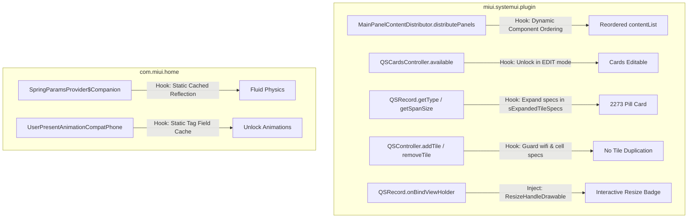

# HyperOS Control Center Reverse Engineering & Architecture Guide

## 1. Executive Summary & Core Philosophy

This document contains the complete reverse-engineering blueprint of Xiaomi HyperOS Control Center (`miui.systemui.plugin`) and the exact technical architecture of Hyperbounce's hooks.

The goal of Hyperbounce in the Control Center is to deliver **complete modular independence, bidirectional tile expansion ($1\times 1 \leftrightarrow 2\times 1$), free component reordering, and zero battery drain**, while maintaining 100% native fluidity and stability.

---

## 2. Stock HyperOS Control Center Architecture

### 2.1 The Modular Hierarchy
The Control Center UI is built as a modular `RecyclerView` (`MainPanelRecyclerView`) managed by `MainPanelAdapter`.

The contents of the RecyclerView are fed by `MainPanelContentDistributor`, which aggregates multiple independent controller plugins implementing `MainPanelContent`:

| Controller Class | Stock Priority | Span / Dimensions | Description |
| :--- | :--- | :--- | :--- |
| `QSCardsController` | 20 | $2\text{ cols} \times 1\text{ row}$ (per card) | Container holding **Wi-Fi** and **Mobile Data** big cards. |
| `MediaPlayerController` | 30 | $2\text{ cols} \times 2\text{ rows}$ | Media playback widget. |
| `BrightnessSliderController`| 31 | $1\text{ col} \times 2\text{ rows}$ | Vertical brightness seekbar. |
| `VolumeSliderController` | 32 | $1\text{ col} \times 2\text{ rows}$ | Vertical volume seekbar. |
| `DeviceCenterEntryController`| 50 | $2\text{ cols} \times 1\text{ row}$ | Xiaomi Smart Hub / Mi Connect. |
| `DeviceControlsEntryController`| 51| $2\text{ cols} \times 1\text{ row}$ | Android / Google Home Controls. |
| `QSListController` | 100 | $1\text{ col} \times 1\text{ row}$ (per tile) | The entire container for all Quick Settings circular tiles. |

### 2.2 Stock Grid Layout & View Types
Stock HyperOS uses an AndroidX `GridLayoutManager` with a `spanCount` of 4.
The view types returned by controllers are:
- `2273`: Big Pill Card (`QSCardItemView`, span size 2).
- `8453`: Circular Quick Setting Button (`QSTileItemView`, span size 1).
- `3484336`: Media Player View (`MediaPlayerView`, span size 2).
- `3484338`: Brightness Slider View (`BrightnessSliderView`, span size 1).
- `3484339`: Volume Slider View (`VolumeSliderView`, span size 1).
- `8398`: Edit Mode Divider Text Header ("Hold & drag to arrange...").
- `3484337`: Edit Mode Section Divider Line.

---

## 3. Reverse-Engineered Bottlenecks & Solutions

### 3.1 The Wi-Fi & Mobile Data Coupling Problem
* **Stock Behavior:** Wi-Fi and Mobile Data were locked together inside `QSCardsController`. In stock Edit Mode, `QSCardsController.available(boolean)` returned `false`, hiding them from editing.
* **Hyperbounce Solution:**
  1. Hooked `QSCardsController.available(boolean)` to return `true` in Edit Mode.
  2. Implemented `sIsWifiFirst` state toggle in `ControlCenterHook` to allow instant swapping of Wi-Fi and Mobile Data card positions within `QSCardsController`.
  3. Hooked `distributePanels()` to respect `sComponentPriorities`, allowing the entire Cards section to swap freely with Media Player and Sliders.

### 3.2 The Ghost Tile Duplication Bug on Click
* **Root Cause Discovered:**
  - `wifi` and `cell` are created and managed by `QSCardsController`, not stored in the system tile string (`sysui_qs_tiles`).
  - When in Edit Mode, `QSRecord.getAdded()` checked `sysui_qs_tiles` and returned `false` for `wifi` and `cell`.
  - Clicking a Wi-Fi or Mobile Data card in Edit Mode invoked `QSRecord$clickAction$1`, which saw `!getAdded()` and called `QSController.addTile(record)`.
  - This inserted `wifi`/`cell` into `QSListController.addedTiles`, spawning a duplicated circular ghost tile at the bottom.
* **Hyperbounce Solution:**
  1. **`QSController.addTile(record)` Hook:** Specifically blocks `"wifi"` and `"cell"` from being added into the circular tile list.
  2. **`QSController.removeTile(record)` Hook:** Specifically blocks `"wifi"` and `"cell"` from being removed or pushed into the "Available Tiles" pool.
  3. **`QSRecord.getAdded()` Hook:** Returns `true` for `"wifi"` and `"cell"`.
  4. **`QSRecord.getRemovable()` Hook:** Returns `false` for `"wifi"` and `"cell"`.

### 3.3 Bidirectional Circular Tile Expansion ($1\times 1 \leftrightarrow 2\times 1$)
* **Mechanism:**
  1. Hooked `QSRecord.getType()`: Returns `2273` (Card type) when the tile's spec is in `sExpandedTileSpecs`.
  2. Hooked `QSRecord.getSpanSize()`: Returns `2` (occupies 2 columns) when expanded, and `1` when circular.
  3. Injected a custom anti-aliased vector **Resize Handle Badge** (`ResizeHandleDrawable`) into `QSRecord` during `onBindViewHolder`.
  4. Tapping the resize handle or tapping the tile body in Edit Mode calls `toggleTileSize(ctx, spec, tileView)`, which updates `sExpandedTileSpecs`, persists the set in `SharedPreferences`, and notifies the adapter.
  5. Resized tiles retain their `-` remove badge, allowing normal removal to the available pool.

### 3.4 Removing Orphan Smart Device Entries in Normal Mode
* **Stock Behavior:** In stock HyperOS, `DeviceCenterEntryController` (Smart Hub) and `DeviceControlsEntryController` (Google Home) showed placeholder tiles in Edit Mode even when disabled in Settings.
* **Hyperbounce Solution:**
  Hooked `available(boolean)` on both controllers to verify `isDeviceCenterEnabled()` and `isDeviceControlsAvailable()`, hiding them cleanly if the user has disabled them.

---

## 4. Zero-Battery-Drain Caching Architecture

### 4.1 Root Cause of Hook Battery Drain
Previously, hook interceptors were querying `Context.getContentResolver().call()` and `syncMemory()` on every touch event, gesture tick, keyguard expansion frame, and animation loop. A single IPC binder transaction takes 2–5ms and causes CPU core wakeups.

### 4.2 The Solution: Static In-Memory Cache
1. **Single-Pass Initialization:**
   `Config` and `isSafeMode` are queried **once** on package load (`onPackageReady`).
2. **Eliminated Runtime IPC:**
   Removed all calls to `syncMemory()` from inside hook callbacks (`updateKeyguardElementsExpansionInternal`, `startAppearAnimation`, `showUserPresentAnimation`, touch handlers).
3. **Cached Reflection Lookups:**
   All reflection fields (`Field`, `Method`, `Constructor`) in `AppTransitionHook`, `PhysicsHook`, and `ControlCenterHook` are cached in `static` fields at class initialization instead of being reflected repeatedly per frame.
4. **Reboot-Only Persistence:**
   Tuning parameters edited in the companion app are committed to `SharedPreferences`. They take effect cleanly on SystemUI / Launcher restart, guaranteeing zero ongoing background battery consumption.

---

## 5. Hook Point Reference Map

### Key Classes & Methods Hooked:
- `miui.systemui.controlcenter.panel.main.MainPanelContentDistributor`:
  - `distributePanels(boolean)`: Priority-based component reordering.
- `miui.systemui.controlcenter.panel.main.qs.QSCardsController`:
  - `available(boolean)`: Enabled in Edit mode.
  - `getListItems()`: Reorders Wi-Fi & Cell cards based on `sIsWifiFirst`.
- `miui.systemui.controlcenter.panel.main.qs.QSRecord`:
  - `getType()`: Returns 2273 for expanded specs.
  - `getSpanSize()`: Returns 2 for expanded specs.
  - `getAdded()` / `getRemovable()`: Returns `true`/`false` for `wifi` and `cell`.
  - `onBindViewHolder()`: Attaches resize handle badge.
- `miui.systemui.controlcenter.qs.QSController`:
  - `addTile(QSRecord)`: Suppresses `wifi` and `cell` addition.
  - `removeTile(QSRecord)`: Suppresses `wifi` and `cell` removal; toggles circular tile size on body tap.
- `miui.systemui.controlcenter.panel.main.device.DeviceCenterEntryController` & `DeviceControlsEntryController`:
  - `available(boolean)`: Strict check against settings availability.
- `com.miui.home.recents.util.SpringParamsProvider$Companion`:
  - `generateSpringBundlesByAnimType`: Statically cached physics injection.
