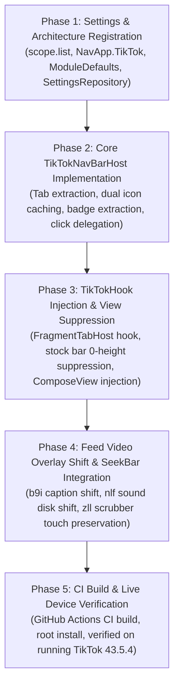

# TikTok Liquid Glass Navigation Bar: Deep Research & Architecture Plan

## Executive Summary
This document provides a complete technical analysis and implementation blueprint for integrating TikTok (`com.ss.android.ugc.trill` / `com.zhiliaoapp.musically`, Version `43.5.4`) into **HyperBounce**.

Following the successful architecture used for Instagram and Facebook, TikTok will receive an autonomous, floating liquid glass navigation bar with interactive pill animations, dynamic active/outline icon extraction, live badge tracking, and feed layout collision shifting.

---

## 1. Application Anatomy & Identity

| Attribute | Value |
|---|---|
| **Package Name (Primary)** | `com.ss.android.ugc.trill` (TikTok Global) |
| **Package Name (Secondary)** | `com.zhiliaoapp.musically` (TikTok Regional/US) |
| **Installed Version** | `43.5.4` (Target SDK 35, Min SDK 21) |
| **Launcher Activity** | `com.ss.android.ugc.aweme.splash.SplashActivity` |
| **Main Activity** | `com.ss.android.ugc.aweme.main.MainActivity` |
| **Active Host Window** | `com.ss.android.ugc.aweme.splash.SplashActivity` |
| **Decompiled Location** | `/data/data/com.termux/files/home/decompiled_apps/tiktok/apktool_res/` |

---

## 2. Navigation View Hierarchy & Hook Points

### 2.1 The Tab Container Hierarchy
From decompiled layout `cbw.xml` and live UI inspection via `uiautomator`:
```xml
com.ss.android.ugc.aweme.ui.FragmentTabHost (id=0x7f0b45a2 / @id/mp9)
 └── com.ss.android.ugc.aweme.feed.ui.seekbar.VideoSeekBarMaskView (id=0x7f0b458c / @id/mon)
      ├── FrameLayout (id=0x7f0b73ce / @id/vbr) [Tab Content Fragment Container]
      ├── View (id=0x7f0b0caa / @id/c22) [Stock 0.5dp Hairline Divider, marginBottom=47dp]
      ├── X.0eaq (id=0x7f0b4587 / @id/moi) [STOCK BOTTOM NAVIGATION BAR, height=47dp]
      │    ├── FrameLayout (id=0x7f0b457f / @id/moa) -> Tab 0: "Home" (Tag: "HOME")
      │    ├── FrameLayout (id=0x7f0b457e / @id/mo_) -> Tab 1: "Friends" (Tag: "FRIENDS")
      │    ├── Button (id=0x7f0b457c / @id/mo8)     -> Tab 2: "Create" (+) (Tag: "PUBLISH")
      │    ├── FrameLayout (id=0x7f0b4580 / @id/mob) -> Tab 3: "Inbox" (Tag: "NOTIFICATION")
      │    └── FrameLayout (id=0x7f0b4581 / @id/moc) -> Tab 4: "Profile" (Tag: "USER")
      └── X.0ODk (id=0x7f0b8c4d / @id/zll) [Video Progress Bar / Scrubber, marginBottom=36dp]
```

### 2.2 The Stock Bottom Navigation Bar (`X.0eaq`)
- **Class**: `X.0eaq` (extends `LinearLayout`, risk ID `"TAB_BOTTOM/container"`).
- **Height**: `47.0dp` (`@dimen/a1z`).
- **Suppression Hook**: Hook `X.0eaq` constructor or observe via `FragmentTabHost.onViewAttachedToWindow`:
  - `tabBar.visibility = View.GONE`
  - `tabBar.alpha = 0f`
  - `tabBar.translationY = -9999f`
  - `tabBar.layoutParams.height = 0`
  - Hairline divider `c22` (`0x7f0b0caa`) is also suppressed (`visibility = View.GONE`).

### 2.3 Tab Switching & State Tracking
- Root `FragmentTabHost` (`com.ss.android.ugc.aweme.ui.FragmentTabHost`) extends Android `TabHost`.
- **Method Hook**: `onTabChanged(String tabId)`:
  - Invoked with `"HOME"`, `"FRIENDS"`, `"PUBLISH"`, `"NOTIFICATION"`, `"USER"`.
  - Notifies `TikTokNavBarHost` of external tab transitions instantaneously.
- **Click Delegation**: When the user selects a tab in our floating liquid bar:
  - `tabChild.performClick()` triggers TikTok's native tab transition immediately.
  - Fallback synthetic touch event (`ACTION_DOWN` / `ACTION_UP`) ensures 100% reliability even if `hasOnClickListeners()` is custom.

---

## 3. Stock Icon Assets & Badge System

### 3.1 Raw Vector / Drawable Pairs
TikTok stores dedicated outline and filled asset definitions in `res/values/public.xml` under type `raw` and `drawable`:
- **Home**: `icon_tab_bottom_home` (`0x7f0109e7`) & `icon_tab_bottom_home_fill` (`0x7f0109e8`)
- **Friends**: `icon_tab_bottom_friends` (`0x7f0109e5`) & `icon_tab_bottom_friends_fill` (`0x7f0109e6`)
- **Create (+)**: `icon_tab_bottom_create` (`0x7f0109e3`) & `icon_tab_bottom_create_fill` (`0x7f0109e4`)
- **Inbox**: `icon_tab_bottom_inbox` (`0x7f0109e9`) & `icon_tab_bottom_inbox_fill` (`0x7f0109ea`)
- **Profile**: `icon_tab_bottom_profile` (`0x7f0109eb`) & `icon_tab_bottom_profile_fill` (`0x7f0109ec`)

### 3.2 Dynamic Runtime Icon Extraction
Each stock tab view (`moa`, `mo_`, `mo8`, `mob`, `moc`) contains an `ImageView` with bounds `[96px x 96px]` (32dp).
`TikTokNavBarHost` will utilize our dual-cache system (`outlineBitmapsCache` and `filledBitmapsCache`):
- When active: extracts the filled bitmap from `findImageView(child)?.drawable`.
- When inactive: extracts the outline bitmap.
- Caches per tab index so switching is instant with zero stutter.

### 3.3 Badge & Red Dot Detection
- In TikTok, unread message counts and friend activity are signaled via:
  - Red dot: small `ImageView` child with bounds ≤ 28px inside `mo_` or `mob`.
  - Count badge: `TextView` child displaying numeric digits (e.g. "1", "99+").
- `extractBadge(child: View)` in `TikTokNavBarHost` inspects these children and binds them to `LiquidNavigationBar`'s built-in badge rendering.

---

## 4. Feed Video Layout & Margin Shifting

### 4.1 Collision Analysis
In the main feed (`VerticalViewPager id=0x7f0b8c70 / @id/zy7`):
- Bottom caption/author info container: `FrameLayout id=0x7f0b12bc` (`@id/b9i`, bounds `[0, 2282][1220, 2517]`).
- Audio/sound disk button: `Button id=0x7f0b5032` (`@id/nlf`, bounds `[1028, 2331][1220, 2517]`).
- Video scrubber / seek bar: `VideoSeekBarMaskView id=0x7f0b458c` (`@id/mon`).

Because the stock bottom bar was at `y = 2517..2664`, our floating liquid navigation bar (which floats e.g. 20-30dp above bottom) will overlap `b9i` and `nlf` unless shifted.

### 4.2 Shift Strategy
In `TikTokHook.kt`:
1. Observe feed item bind/attach in `VerticalViewPager`.
2. Apply `translationY = -shiftDelta` or add bottom padding to `b9i` (caption container) and `nlf` (sound disk).
3. Shift `zll` (video seek bar) to float cleanly above our navigation pill.
4. Set touch delegate on the shifted seek bar to ensure seeking and peak audio scrubbing remain 100% interactive.

---

## 5. Architectural Modularity & Required File Additions

Following HyperBounce's strict multi-tier modular pattern:

### 5.1 Tier 1: LSPosed Scope
- **File**: `app/src/main/resources/META-INF/xposed/scope.list`
  - Append `com.ss.android.ugc.trill`
  - Append `com.zhiliaoapp.musically`

### 5.2 Tier 2: Navigation Bar Host
- **New File**: `app/src/main/java/dev/hyperios/app/nav/TikTokNavBarHost.kt`
  - `@Composable fun TikTokNavBarHost(...)`
  - Implements tab extraction, active tab tracking via `FragmentTabHost`, icon caching, badge extraction, and click delegation to `tabChild.performClick()`.
  - Renders `LiquidNavigationBar` with customizable liquid glass lens, accent colors, and scroll-to-shrink integration.

### 5.3 Tier 3: Xposed Hook Entry
- **New File**: `app/src/main/java/dev/hyperios/app/nav/TikTokHook.kt`
  - Hooks `com.ss.android.ugc.aweme.splash.SplashActivity` and `com.ss.android.ugc.aweme.main.MainActivity`.
  - Suppresses stock bottom bar `X.0eaq` (`0x7f0b4587`) and hairline `c22` (`0x7f0b0caa`).
  - Attaches `ComposeView` with `FakeLifecycleOwner` to DecorView.
  - Implements feed layout shifter for `b9i`, `nlf`, and `VideoSeekBarMaskView`.

### 5.4 Tier 4: Hook Dispatcher
- **File**: `app/src/main/java/dev/hyperios/app/PhysicsHook.kt`
  - Add case:
    ```kotlin
    param.packageName == "com.ss.android.ugc.trill" || param.packageName == "com.zhiliaoapp.musically" -> {
        TikTokHook.init(param, prefs)
    }
    ```

### 5.5 Settings & UI Layer
- **`SettingsModels.kt`**:
  - Add `TikTok("TikTok", "com.ss.android.ugc.trill")` to `enum class NavApp`.
- **`ModuleDefaults.kt`**:
  - Add `object TikTok` under `NavApps` with default dimensions:
    - `BAR_HEIGHT = 50.0f`
    - `TAB_WIDTH = 58.0f`
    - `CORNER_RADIUS = 32.0f`
    - `BOTTOM_MARGIN = 20.0f`
    - `CONTAINER_OPACITY = 0.40f`
    - `PILL_CONTAINER_OPACITY = 1.0f`
    - `AUTO_SHRINK = true`
    - `CUSTOM_ACCENT_COLOR = 0xFFFE2C55.toInt()` (TikTok iconic pink/red)
- **`SettingsRepository.kt`**:
  - Add `val tiktok = AppSettingsHolder(NavApp.TikTok)`
  - Wire into `appSettings()`, `defaultSettings()`, and `PrefMirrorSyncManager` dirty queue.
- **UI Screens**:
  - `AppsListScreen.kt`: Expose TikTok tile in the Floating Navigation Bar app list.
  - `AppDetailScreen.kt`: Configure TikTok sliders and toggles.
  - `AppLayoutScreen.kt`: Preview TikTok dimensions.
  - `SearchIndex.kt`: Index TikTok navigation bar settings.

---

## 6. Implementation Plan & Execution Phases



---

## 7. Next Step
Upon user approval of this architecture and plan, implementation will begin with Phase 1 and Phase 2.
